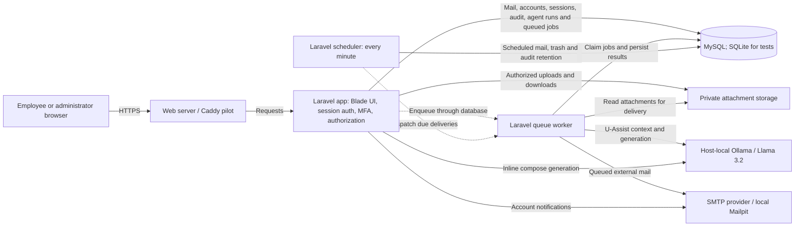

# U-Mail architecture

This diagram describes the implementation on `main` after the security changes. It is a Laravel monolith with a separate queue worker and scheduler.

## Trust boundaries

- Every mailbox, attachment and agent-run request is scoped to the signed-in user. Administrator status does not grant access to other employees' messages.
- U-Assist receives authorized mailbox context. Model output is untrusted; prepared actions are checked again when the user confirms them. Draft creation also validates thread and parent-message ownership.
- Files live outside the public web root. Controllers authorize downloads and previews before reading them.
- Passwords are one-way hashes. Reset codes are hashed, expire after 15 minutes, and are consumed once; resets revoke sessions. The former credential registry is removed by a migration.
- Ollama is host-local in the coworker pilot. Remote browsers access Laravel, not the Ollama port. SMTP is a separate integration; local Mailpit captures development mail.

## Trade-off

A Laravel monolith and database-backed queue simplify deployment, transactional mailbox updates, and debugging. The cost is shared database load and less independent scaling than dedicated messaging infrastructure. Separate workers keep long-running mail delivery and AI requests out of ordinary HTTP requests; inline compose remains synchronous and can wait on model latency.

## Source map

The diagram follows `routes/web.php`, `MailService`, `AgentRunController`, `UmailAgentService`, `LocalAgentEngineService`, `ProcessAgentRun`, `DeliverExternalMessage`, `config/queue.php`, and `routes/console.php`. A screenshot walkthrough does not establish production delivery, model accuracy, or throughput.
